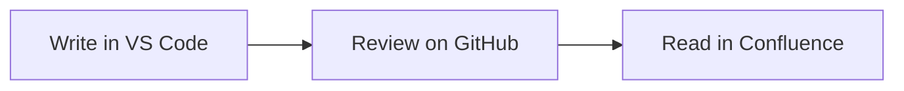

<!-- _class: lead -->
<!-- _paginate: false -->

# Markdown 101

You already write it. Let's write it on purpose.

30 minutes · bring a laptop

<!--
Presenter notes: welcome, 30 minutes, hands-on. Ask everyone to open VS Code, Notepad, or the OneDrive app now. In the OneDrive iPhone app it's + › Markdown Document (check the web version before the session).
-->

---

## You already use Markdown

- In **Teams**, you type `` `code` `` and it turns into `code`
- **Copilot** answers with headings, bold, and bullet lists
- Every **GitHub** README is a Markdown file

<!--
Hook (0:00-0:03). Live: send a Teams message with backticks. Then show a Copilot answer.
-->

---

## What Copilot actually sends

```markdown
## Summary

The release is **on track**. Remaining work:

- Fix the login bug
- Update the user guide
```

That's Markdown. The chat window turns it into formatting.

<!--
Show the raw text of a real Copilot answer if you can (copy it into VS Code). "This is why chatbot answers look nice."
-->

---

## What is Markdown?

- **Plain text** with a few symbols that mean formatting
- Created in **2004** by John Gruber, with Aaron Swartz
- Readable as-is, and converts cleanly to HTML, Word, PDF, slides

> A Markdown file still makes sense if the app that made it disappears.

---

## Why bother?

| | |
|:---|:---|
| **Readable raw** | No app needed to understand it |
| **Portable** | Any editor, any OS, OneDrive, GitHub, phones |
| **Future-proof** | It's just text |
| **Reviewable** | Changes show up clearly in Git |
| **AI-native** | Copilot reads and writes it, so your docs are Copilot-ready |

---

## Follow along

Create a file called `notes.md` in any of these:

- **VS Code**: open preview side by side with `Ctrl+K V`
- **Notepad** on Windows 11
- **OneDrive** app or web: *Add New* › *Markdown Document*

Type along. Typos are fine.

<!--
Core 80% starts (0:06-0:16). Live demo in VS Code with preview open. Keep a steady pace: about one minute per slide.
-->

---

## Headings

```markdown
# Project Phoenix
## Goals
### Stretch goals
```

- One `#` per level, then a space
- One `# Title` per file, and don't skip levels

---

## Paragraphs

```markdown
This is one paragraph. It can wrap
across lines in the source.

A blank line starts a new paragraph.
```

The blank line is the most important character in Markdown.

---

## Bold and italic

| You type | You get |
|:---|:---|
| `**bold**` | **bold** |
| `*italic*` or `_italic_` | *italic* |
| `***both***` | ***both*** |

---

## Lists

```markdown
- Milk
- Eggs
  - Free range
- Bread

1. Open the file
2. Make the change
3. Save
```

Indent two spaces to nest.

---

## Links and images

```markdown
[Markdown Guide](https://www.markdownguide.org/)


```

An image is a link with a `!` in front. The text in `[ ]` is the alt text.

---

## Code

Inline: `` `npm install` `` gives `npm install`

A block: three backticks and a language name

````markdown
```powershell
Get-ChildItem *.md
```
````

---

## Quotes and dividers

```markdown
> Write it once, read it anywhere.

***
```

> Write it once, read it anywhere.

`***` (or `---`) draws a line between sections.

---

## The core 80%

| | |
|:---|:---|
| Heading | `# Title` |
| Bold, italic | `**bold**`, `*italic*` |
| List | `- item`, `1. item` |
| Link, image | `[text](url)`, `` |
| Code | `` `code` ``, three backticks |
| Quote | `> quote` |

This works almost everywhere: GitHub, VS Code, Copilot, OneDrive, slides.

---

<!-- _class: lead -->

# Level up

Tables, task lists, diagrams

<!--
Level up (0:16-0:21).
-->

---

## Tables

```markdown
| Owner | Task          | Due    |
|:------|:--------------|:-------|
| Sam   | Update guide  | Fri    |
| Alex  | Fix login bug | Mon    |
```

| Owner | Task | Due |
|:---|:---|:---|
| Sam | Update guide | Fri |
| Alex | Fix login bug | Mon |

The columns don't need to line up. VS Code can format them for you.

---

## Task lists

```markdown
- [x] Book the room
- [ ] Send the agenda
- [ ] Order coffee
```

GitHub shows these as checkboxes you can tick.

<!--
Show this rendered on GitHub, not on the slide.
-->

---

## Diagrams as code



GitHub draws this as a diagram. Change a word, the diagram updates.

*This could replace your draw.io diagram.*

<!--
Switch to GitHub or VS Code (with a Mermaid extension) to show it rendered. Marp doesn't draw Mermaid, which is a nice reminder that flavors differ.
-->

---

## Same characters, different result

| You type | Markdown | Teams chat |
|:---|:---|:---|
| `*hello*` | *hello* | **hello** |
| `_hello_` | *hello* | *hello* |
| `` `hello` `` | `hello` | `hello` |
| A table | a table | plain text |

Each app has its own **flavor**. Teams has chat shortcuts, not real Markdown.

<!--
Check every row in Teams before the session (prep checklist).
-->

---

## Our standard

- Write **GitHub Flavored Markdown**: the core 80% plus tables and task lists
- The core works **everywhere**
- Tables, task lists, and diagrams work in **files**: GitHub, VS Code, Confluence via publishing
- In **chat**, stick to bold, italic, and code

---

## Exercise: rescue the recap

Open `teams-recap-before.md` from the shared folder.

1. Add a heading and a date
2. Turn the decisions into a list
3. Put the action items in a table or task list
4. Bold anything urgent

**Bonus:** ask Copilot to do it, then check what it got wrong.

5 minutes. Go!

<!--
Exercise (0:21-0:26). Walk around or watch chat. Show one or two results, then teams-recap-after.md.
-->

---

## Keep going

- **Cheat sheet**: in the shared OneDrive folder
- **VS Code extensions**: markdownlint, a Mermaid preview, Marp
- **Learn more**: [markdownguide.org](https://www.markdownguide.org/), [commonmark.org/help](https://commonmark.org/help/)
- **Next session**: write docs in Git, read them in Confluence

<!--
Wrap (0:26-0:27). Quick, then straight into questions.
-->

---

<!-- _class: lead -->
<!-- _paginate: false -->

# Questions?

<!--
Q&A (0:27-0:29). Questions come BEFORE the close, so the last thing people hear is the takeaway, not a random question.
Stop at 0:29 even if hands are up: "Let's take the rest after. One last thing..."
If nobody asks, seed one: "A common question is: does this work in Confluence?"
-->

---

<!-- _class: lead -->
<!-- _paginate: false -->

# One more thing

This whole deck is **one Markdown file**.

Write your next meeting note in Markdown.

<!--
Close (0:29-0:30). Open microsoft-slides.md in VS Code and scroll through it, then say the call to action and stop. No "any other questions?" after this.
-->
