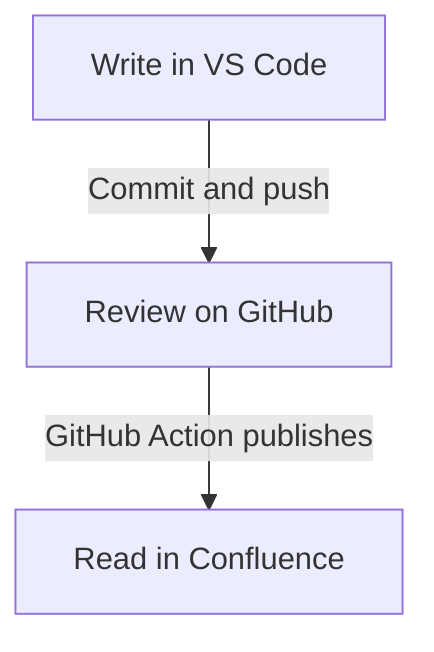

## Diagrams as code



````markdown

````

- GitHub draws this as a diagram
- Change a word, the diagram updates
- `TB` is Top-to-Bottom, `LR` is Left-to-Right
- This will replace draw.io diagrams

<!--
The picture on the right is media/confluence-publishing-flow.svg, exported from media/confluence-publishing-flow.mmd. Marp doesn't draw Mermaid itself, which is a nice reminder that flavors differ. Switch to GitHub or VS Code (with a Mermaid extension) to show it drawing live.
The GitHub Action that publishes to Confluence is the workflow this diagram describes (verify it's set up before you promise it).
-->
