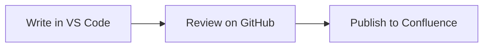

# Phoenix weekly sync

- **Date:** November 20
- **Attendees:** Sam, Priya, Alex, Jordan (joined late)

## Decisions

- Release date stays **December 12**.
- Move the user guide to GitHub and publish it to Confluence, instead of editing it in Confluence.
- Replace the draw.io architecture diagram with Mermaid.

> **Urgent:** the login bug must be fixed before the release, or the date slips.

## Action items

| Owner | Task | Due |
|:---|:---|:---|
| Sam | **Fix the login bug** | Monday |
| Priya | Move the user guide to GitHub | Friday |
| Alex | Redraw the architecture diagram in Mermaid | Friday |
| Jordan | Book the demo room | Done |

Or, as a task list:

- [ ] Sam: **fix the login bug** (Monday)
- [ ] Priya: move the user guide to GitHub (Friday)
- [ ] Alex: redraw the architecture diagram in Mermaid (Friday)
- [x] Jordan: book the demo room

## Links

- [Release plan](https://example.com/phoenix/release-plan)
- [Old architecture diagram](https://example.com/phoenix/architecture)

## Next meeting

Thursday, 10:00, same room.

## Bonus: Alex's diagram, started

