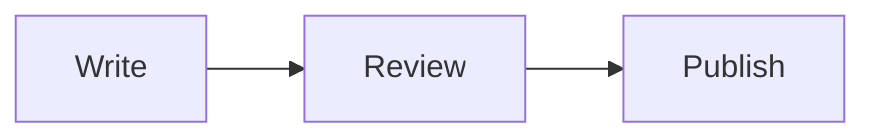

## Diagrams as code

````markdown

````

- GitHub draws this as a diagram
- Change a word, the diagram updates
- `LR` is Left-to-Right, `TB` is Top-to-Bottom

<!--
Marp doesn't draw Mermaid itself, which is a nice reminder that flavors differ. Switch to GitHub, or VS Code with a Mermaid extension, to show it drawn.
-->
