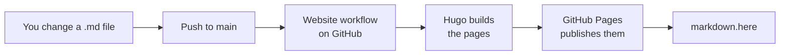

# The website

[markdown.here](https://markdown.here/) is built from the Markdown files in this repo. Nothing is copied: when you change a course page or a reference, the site changes too. Setting it up the first time is a separate guide: [Website setup](website-setup.md).

## How it works



- **[Hugo](https://gohugo.io/)** is the program that turns Markdown into web pages.
- **[Hextra](https://imfing.github.io/hextra/)** is the theme: the look, the sidebar, search, dark mode, and diagrams.
- **[GitHub Pages](https://docs.github.com/en/pages)** hosts the pages for free.
- **The [Website workflow](../.github/workflows/pages.yml)** runs all of it on every push to `main`. It takes about 2 minutes **(verify)**.

You never edit web pages and you never commit them. The workflow builds them fresh each time.

## Which file does what

| File | What it does | How often you touch it |
|---|---|---|
| The `.md` files in `course/`, `references/`, `microsoft-atlassian/`, `docs/` | The content | All the time |
| [`hugo.yaml`](../hugo.yaml) | Settings: which folders become pages, the menu, page titles and order, downloads | When you add a section, or change the order |
| [`site/content/`](../site/content/) | The home page and the Courses page, which exist only on the site | Rarely |
| [`site/layouts/`](../site/layouts/) | Templates that turn our files into pages | Almost never |
| [`site/assets/css/custom.css`](../site/assets/css/custom.css) | Colors and small style fixes | Almost never |
| [`go.mod`](../go.mod) | Which version of the Hextra theme to use | When you upgrade it |
| [`.github/workflows/pages.yml`](../.github/workflows/pages.yml) | Builds, checks, and publishes. Also sets the Hugo version | When you upgrade Hugo |

## Where each file shows up

| In the repo | On the site |
|---|---|
| `course/markdown-101/README.md` | `/courses/markdown-101/` |
| `course/markdown-101/cheatsheet.md` | `/courses/markdown-101/cheatsheet/` |
| `references/tools/pandoc.md` | `/tools/pandoc/` |
| `references/tools.md` (the generated list) | `/tools/` |
| `references/README.md` | `/references/` |
| `microsoft-atlassian/markdown-support.md` | `/microsoft-atlassian/markdown-support/` |
| `docs/building.md` | `/contribute/building/` |
| `media/confluence-publishing-flow.svg` | `/media/confluence-publishing-flow.svg` |

A `README.md` becomes its folder's main page. Slides (`slides/` folders), deck files, `references/inbox.md`, `templates/`, and `scripts/` aren't on the site. The rules are under `sources` in [`hugo.yaml`](../hugo.yaml).

**URLs are permanent**, like slugs. Renaming a file changes its URL and breaks every link to it from other sites.

## Change something

### Edit a page

Edit the `.md` file and push. Every page on the site also has an **Edit this page on GitHub** link.

- The page title comes from the first `# heading`. Don't put a `title:` in the frontmatter; the site ignores it unless there's no heading.
- Link to other files the same way you do for GitHub: `[Pandoc](../references/tools/pandoc.md)`. The site turns that into `/tools/pandoc/`. A link to a file that isn't a page, like `deck.yml`, opens it on GitHub.
- A link to a `.md` file that doesn't exist stops the build, so a typo can't reach the site.

### Add a course page

1. Add the file under `course/`, with `type` frontmatter and a `# Title`, as usual.
2. Push. It shows up in the course sidebar.

To put it in a set place in the sidebar, give it a `weight` under `pages` in `hugo.yaml`. Lower numbers come first. Pages without a weight go after the others, A to Z:

```yaml
  pages:
    course/markdown-101/my-new-page.md: { weight: 9 }
```

The same place takes a `title`, for files whose `# heading` isn't a good page title (the exercises), and `downloads`, for links to release files.

### Add a reference

Nothing changes: follow [Adding an entry](../references/README.md#adding-an-entry), run `python scripts/build_references.py`, and push. The entry gets its own page, like `/tools/pandoc/`, and shows up in the list, the sidebar, its tag pages, and search.

### Add a new folder to the site

1. Add a line under `sources` in `hugo.yaml`, like `- { from: guides/, to: guides/ }`.
2. Give the folder a `README.md`. It becomes the folder's main page.
3. To add it to the top menu, add a line under `menu: main:`, like `- { name: Guides, pageRef: /guides, weight: 4 }`.

## Preview on your computer

You don't have to: the workflow checks every push. But a preview shows your change in a second, before anyone else sees it.

### One-time setup on Windows

Open **Terminal** (or PowerShell) and install three programs:

```bat
winget install Hugo.Hugo.Extended
```

```bat
winget install GoLang.Go
```

```bat
winget install Git.Git
```

Close the terminal and open a new one, so it finds them. Check with `hugo version`: it should say `extended`. Hugo needs Go to download the theme.

### One-time setup on Android (Termux)

```bash
pkg install hugo golang git
```

Check with `hugo version`. **(verify)** that Termux's Hugo says `extended`.

### Preview

From the repo folder:

```bash
hugo server
```

Open <http://localhost:1313/> in your browser. Leave the command running: when you save a `.md` file, the page reloads by itself. Stop it with **Ctrl+C** when you're done.

The first run downloads the theme, so it needs internet access.

## Publish

Push to `main`. That's all.

1. On GitHub, open **Actions › Website**. A run appears within a minute.
2. When it turns green, the change is live. Refresh [markdown.here](https://markdown.here/).

If it turns red, open the run and click the step with the ❌. The table below covers the usual causes.

Pull requests run the same build and checks, but don't publish.

## Downloads

Course pages link to the slides and cheat sheets on the [latest release](https://github.com/thephm/markdown/releases/latest). The [Course workflow](../.github/workflows/course.yml) builds them when you tag a version (see [Release a version](../RELEASING.md)). Until the first version is tagged, the download links don't work.

## Upgrade

**Hugo:** change `HUGO_VERSION` in [`pages.yml`](../.github/workflows/pages.yml) to the new version from [Hugo releases](https://github.com/gohugoio/hugo/releases). Update Hugo on your computer too (`winget upgrade Hugo.Hugo.Extended`).

**Hextra:** check its [release notes](https://github.com/imfing/hextra/releases) first, then:

```bash
hugo mod get github.com/imfing/hextra@v0.14.0
```

```bash
hugo mod tidy
```

Then preview the site, and commit `go.mod` and `go.sum`. Our two copied templates, `site/layouts/single.html` and `list.html`, come from Hextra's `layouts/docs/`. If a new Hextra version changes those, copy them again.

## Something broke

| Symptom | Cause | Fix |
|---|---|---|
| Build fails with `link "..." points at ..., which doesn't exist` | A link to a `.md` file has a typo, or the file was moved | Fix the link in the file the message names |
| Build fails with `points outside the repo` | Too many `../` in a link | Count the folders again |
| Build fails at **Check the reference lists are up to date** | A reference changed but the lists weren't regenerated | `python scripts/build_references.py`, commit, push |
| Build fails at **Check links inside the website** | A link in `site/` or `hugo.yaml` points at a page that doesn't exist | Fix the path it prints |
| Build fails at **Get the site address** | GitHub Pages isn't turned on yet | Follow [Website setup](website-setup.md) |
| A new page doesn't show up | Its folder isn't under `sources` in `hugo.yaml`, or it's inside a `slides/` folder | Add the folder (see [Add a new folder](#add-a-new-folder-to-the-site)) |
| A page has the wrong title | The title comes from the first `# heading` | Change the heading, or set `title` under `pages` in `hugo.yaml` |
| `hugo server` says `module "github.com/imfing/hextra" not found` | Go isn't installed, or no internet | Install Go, then try again online |
| `hugo server` says it needs the extended version | You installed plain Hugo | Install `Hugo.Hugo.Extended` |
| Download links give "Not Found" | No version has been released yet | Tag one: [Release a version](../RELEASING.md) |
| The site shows an old version | The browser cached it, or the run is still going | Wait for the green run, then hard-refresh (**Ctrl+F5**) |
