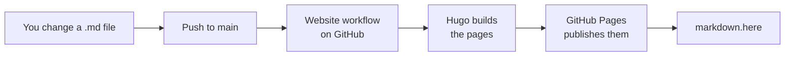

# The website

[markdown.here](https://markdown.here/) is the course for people learning Markdown. It's built from the files in this repo. Nothing is copied: when you change a slide, a cheat sheet, or a reference, the site changes too. Setting it up the first time is a separate guide: [Website setup](website-setup.md).

The site is for learners only. Course plans, these docs, templates, and everything about building and releasing stay here on GitHub. The site's footer links here for anyone who wants to teach the course or contribute.

## How it works



- **[Hugo](https://gohugo.io/)** is the program that turns Markdown into web pages.
- **[Hextra](https://imfing.github.io/hextra/)** is the theme: the look, the sidebar, search, dark mode, and diagrams.
- **[GitHub Pages](https://docs.github.com/en/pages)** hosts the pages for free.
- **The [Website workflow](../.github/workflows/pages.yml)** runs all of it on every push to `main`. It takes about 2 minutes **(verify)**.

You never edit web pages and you never commit them. The workflow builds them fresh each time.

## What's on the site

| On the site | Built from |
|---|---|
| `/courses/markdown-101/` | The course intro in [`site/content/courses/markdown-101/_index.md`](../site/content/courses/markdown-101/_index.md) |
| `/courses/markdown-101/headings/` and the other lessons | One page per slide in `course/markdown-101/slides/`, in the order of [`deck.yml`](../course/markdown-101/deck.yml) |
| `/courses/markdown-101/exercise-before/`, `exercise-after/` | The exercise files, shown as text to copy |
| `/courses/markdown-101/cheatsheet/` | [`cheatsheet.md`](../course/markdown-101/cheatsheet.md) |
| `/courses/markdown-101-microsoft/…` | The same, from the Microsoft edition's deck, slides, cheat sheet, and Teams recap exercise |
| `/tools/`, `/resources/`, `/people/`, `/organizations/` | A table built from [`references.json`](../references/references.json), with each entry's summary |
| `/tools/pandoc/` and the other entries | Each entry file in `references/` |
| `/microsoft-atlassian/` | [`markdown-support.md`](../microsoft-atlassian/markdown-support.md) |
| `/` | The home page in [`site/content/_index.md`](../site/content/_index.md) |

**Not on the site:** the course plans (`course/markdown-101/README.md`, `editions/microsoft.md`), `extending.md`, `docs/`, `RELEASING.md`, `references/README.md`, `inbox.md`, `templates/`, and the rest of `microsoft-atlassian/`. Links to them from the site open them on GitHub.

**Slides left out of the lessons:** slides marked `<!-- _class: lead -->` (title, questions, closing) or `<!-- _class: break -->` (section dividers) are for live sessions. Speaker notes (`<!-- ... -->`) are left out too.

**Reference entries left out:** entries with `state: draft`, `broken`, or `retired`. The list is `hideStates` in [`hugo.yaml`](../hugo.yaml).

**URLs are permanent**, like slugs and slide IDs. Renaming a file changes its URL and breaks every link to it from other sites.

## Which file does what

| File | What it does | How often you touch it |
|---|---|---|
| Slides, cheat sheets, exercises, references | The content | All the time |
| `deck.yml` and `microsoft-deck.yml` | The order of the lessons, same as for the slides | When you add or move a slide |
| [`hugo.yaml`](../hugo.yaml) | Settings: the courses, which other files become pages, the menu, titles and order | When you add a course or a section |
| [`site/content/`](../site/content/) | Pages that exist only on the site: home, the Courses list, each course's intro and downloads | When a course's intro or downloads change |
| [`site/content/_content.gotmpl`](../site/content/_content.gotmpl) | The template that turns repo files into pages | Almost never |
| [`site/layouts/`](../site/layouts/) | The other templates: links, images, the download box, the footer | Almost never |
| [`site/assets/css/custom.css`](../site/assets/css/custom.css) | Colors and small style fixes | Almost never |
| [`go.mod`](../go.mod) | Which version of the Hextra theme to use | When you upgrade it |
| [`.github/workflows/pages.yml`](../.github/workflows/pages.yml) | Builds, checks, and publishes. Also sets the Hugo version | When you upgrade Hugo |

## Change something

### Edit a lesson

Edit the slide file and push. The slide's `## heading` is the lesson's title. Everything else on the slide is the lesson, except speaker notes.

- Link to other files the same way you do for GitHub: `[Pandoc](../../../references/tools/pandoc.md)`. The site turns that into `/tools/pandoc/`. A link to a file that isn't on the site opens it on GitHub.
- A link to a `.md` file that doesn't exist stops the build, so a typo can't reach the site.

### Add, move, or drop a lesson

Change the deck, as you would for the slides (see [Extending Markdown 101](../course/markdown-101/extending.md)). The website follows the deck: a new slide becomes a new lesson in the same place, and a removed slide disappears from the site.

### Edit the cheat sheet, an exercise, or a reference

Edit the file and push. Page titles come from the first `# heading`. For references, run `python scripts/build_references.py` as usual (see [Adding an entry](../references/README.md#adding-an-entry)). A new entry gets its own page, like `/tools/pandoc/`, and shows up in the list, its tag pages, and search once its state is `active`, `watch`, or `stale`.

### Put a page in a set place, or give it another title

Under `pages` in `hugo.yaml`, keyed by the file's repo path:

```yaml
  pages:
    course/markdown-101/exercise-before.md: { title: "Practice: the messy note", after: exercise, order: 1 }
    course/markdown-101/cheatsheet.md: { weight: 100000 }
```

- `title` replaces the `# heading`. The exercises need this, because their heading is the meeting's name.
- `after: exercise` puts the page right after the `exercise` lesson. `order` sorts pages that follow the same lesson.
- `weight` sets a place directly: lessons are 10, 20, 30, and so on, so `100000` means last.

### Add a course

1. Make its deck, as for the slides.
2. Add it under `courses` in `hugo.yaml`, like `- { deck: course/markdown-201/deck.yml, path: courses/markdown-201 }`.
3. Copy `site/content/courses/markdown-101/` to `site/content/courses/markdown-201/` and change the intro text, the downloads, and the first lesson's link.
4. Add a row to the table in `site/content/courses/_index.md`.
5. To add its cheat sheet or exercises, add lines under `sources` in `hugo.yaml`, the way Markdown 101's are.

### Add another file or folder to the site

Add a line under `sources` in `hugo.yaml`, like `- { from: guides/, to: guides/ }`. A file mapped to `<folder>/README.md` becomes that folder's main page. To add it to the top menu, add a line under `menu: main:`, like `- { name: Guides, pageRef: /guides, weight: 4 }`.

## Preview on your computer

You don't have to: the workflow checks every push. But a preview shows your change in a second, before anyone else sees it.

### One-time setup on Windows

Open **Terminal** (or PowerShell) and install three programs:

```bat
winget install Hugo.Hugo.Extended
```

```bat
winget install GoLang.Go
```

```bat
winget install Git.Git
```

Close the terminal and open a new one, so it finds them. Check with `hugo version`: it should say `extended`. Hugo needs Go to download the theme.

### One-time setup on Android (Termux)

```bash
pkg install hugo golang git
```

Check with `hugo version`. **(verify)** that Termux's Hugo says `extended`.

### Preview

From the repo folder:

```bash
hugo server
```

Open <http://localhost:1313/> in your browser. Leave the command running: when you save a file, the page reloads by itself. Stop it with **Ctrl+C** when you're done.

The first run downloads the theme, so it needs internet access.

## Publish

Push to `main`. That's all.

1. On GitHub, open **Actions › Website**. A run appears within a minute.
2. When it turns green, the change is live. Refresh [markdown.here](https://markdown.here/).

If it turns red, open the run and click the step with the ❌. The table below covers the usual causes.

Pull requests run the same build and checks, but don't publish.

## Downloads

Each course's intro page links to its slides and cheat sheet on the [latest release](https://github.com/Markdown-here/markdown/releases/latest). The [Course workflow](../.github/workflows/course.yml) builds them when you tag a version (see [Release a version](../RELEASING.md)). Until the first version is tagged, the download links don't work. The list of files is in each course's `_index.md` in `site/content/courses/`.

## Upgrade

**Hugo:** change `HUGO_VERSION` in [`pages.yml`](../.github/workflows/pages.yml) to the new version from [Hugo releases](https://github.com/gohugoio/hugo/releases). Update Hugo on your computer too (`winget upgrade Hugo.Hugo.Extended`).

**Hextra:** check its [release notes](https://github.com/imfing/hextra/releases) first, then:

```bash
hugo mod get github.com/imfing/hextra@v0.14.0
```

```bash
hugo mod tidy
```

Then preview the site, and commit `go.mod` and `go.sum`. Our copied templates, `site/layouts/single.html` and `list.html`, come from Hextra's `layouts/docs/`, and `site/layouts/_partials/utils/page-description.html` from the same file in Hextra. If a new Hextra version changes those, copy them again.

## Something broke

| Symptom | Cause | Fix |
|---|---|---|
| Build fails with `link "..." points at ..., which doesn't exist` | A link to a `.md` file has a typo, or the file was moved | Fix the link in the file the message names |
| Build fails with `points outside the repo` | Too many `../` in a link | Count the folders again |
| Build fails with `slide "..." not found` or `can't insert next to` | The deck names a slide that doesn't exist | Fix the deck. `python scripts/build_deck.py <deck> --check` gives the same error |
| Build fails with `isn't a lesson in` | An `after:` in `hugo.yaml` names a slide that isn't in that course | Fix the slide ID |
| Build fails at **Check the reference lists are up to date** | A reference changed but the lists weren't regenerated | `python scripts/build_references.py`, commit, push |
| Build fails at **Check links inside the website** | A link in `site/` points at a page that doesn't exist | Fix the path it prints |
| Build fails at **Get the site address** | GitHub Pages isn't turned on yet | Follow [Website setup](website-setup.md) |
| A new slide doesn't show up as a lesson | It isn't in the deck, or it's marked `_class: lead` or `break` | Add it to the deck, or remove the class |
| A new reference doesn't show up | Its state is `draft`, `broken`, or `retired` | Set `state: active` when it's ready |
| A page has the wrong title | The title comes from the first heading | Change the heading, or set `title` under `pages` in `hugo.yaml` |
| `hugo server` says `module "github.com/imfing/hextra" not found` | Go isn't installed, or no internet | Install Go, then try again online |
| `hugo server` says it needs the extended version | You installed plain Hugo | Install `Hugo.Hugo.Extended` |
| Download links give "Not Found" | No version has been released yet | Tag one: [Release a version](../RELEASING.md) |
| The site shows an old version | The browser cached it, or the run is still going | Wait for the green run, then hard-refresh (**Ctrl+F5**) |
