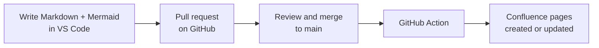

# Work context and constraints

The workplace this site's content (starting with [Markdown 101](../course/markdown-101/)) has to land in. Kept separate from the general site because it's specific to one organization.

> Items marked **(verify)** are from memory or assumption, not tested at work yet.

## The goal

Push **docs-as-code**, **diagrams-as-code**, and **architecture-as-code**: content lives in Markdown in GitHub, is reviewed like code, and is **published automatically to Confluence on check-in**, so people who live in Confluence still find it there.

**Expect it to be an uphill battle.** Confluence is easier for most people. The pitch has to be "you keep reading in Confluence; we write in Git", not "everyone move to GitHub".

## Environment

A Microsoft shop.

| Tool | Who uses it | Markdown support | Notes |
|:---|:---|:---|:---|
| VS Code | Developers, me | Full, with live preview (`Ctrl+Shift+V`) | Approved. The main editor for the course |
| GitHub | Developers | Full GFM, Mermaid renders natively | Source of truth for docs-as-code |
| Confluence | Most project teams | Partial, via shortcuts and macros **(verify)** | Where people read and write today. Target for publishing |
| draw.io (in Confluence) | Project teams | None, it's a diagram tool | Can import Mermaid **(verify)**, which gives a migration path |
| Copilot (M365 and GitHub) | Everyone, developers | Answers are written in Markdown | GitHub Copilot also reads instructions from Markdown files like `.github/copilot-instructions.md` |
| Teams chat | Everyone | Partial, its own rules | See below |
| Loop | Me, some others | Typing shortcuts **(verify)** | I'm moving to Confluence because others live there |
| OneDrive | Everyone | Create, store, and edit `.md` files. The iPhone app has *Add New* › *Markdown Document* | Works today. Web version **(verify)** |
| Notepad (Windows 11) | Everyone | Basic Markdown formatting in recent versions **(verify)** | Zero-install option for the course |

## Which Markdown?

**House standard: [GitHub Flavored Markdown (GFM)](../references/resources/gfm-spec.md).** It's [CommonMark](../references/resources/commonmark-spec.md) plus tables, task lists, strikethrough, and autolinks, and it's what GitHub, Copilot, and most of our tools already speak. Mermaid diagrams sit on top as fenced `mermaid` code blocks.

**What Markdown 101 teaches:** the CommonMark core first, because it works almost everywhere, then the GFM extras, marked "works in files, not always in chat".

Neither Teams nor Confluence follows a spec. Teams has its own chat shortcuts. Confluence turns some Markdown into rich text as you type or paste, and stores pages in its own format, so the docs-as-code pipeline converts GFM on publish.

| Feature | CommonMark | GitHub (GFM) | VS Code preview | Marp slides | Teams chat | Confluence Cloud editor |
|:---|:---|:---|:---|:---|:---|:---|
| Headings `#` | yes | yes | yes | yes | ? | as you type ? |
| `**bold**` `*italic*` | yes | yes | yes | yes | `*x*` is **bold**, italic is `_x_` | ? |
| Lists | yes | yes | yes | yes | ? | as you type ? |
| Links `[text](url)` | yes | yes | yes | yes | ? | ? |
| `` `code` `` and fenced code | yes | yes | yes | yes | yes | as you type ? |
| Blockquote `>` | yes | yes | yes | yes | ? | as you type ? |
| Tables | no | yes | yes | yes | no | no, use the table tool ? |
| Task lists `- [ ]` | no | yes | ? | ? | no | `[]` as you type ? |
| Strikethrough `~~x~~` | no | yes | yes | yes | `~x~` ? | ? |
| Mermaid | no | yes | with an extension | no, use an image | no | with an app or as an image ? |

`?` means not tested yet. Fill it in during the [prep checklist](../course/markdown-101/editions/microsoft.md#prep-checklist).

Pasting Markdown into Confluence Cloud is reported to work only sometimes (it depends on the browser and the editor version), and there's no native Markdown macro without a Marketplace app ([Atlassian Community](https://community.atlassian.com/forums/Confluence-questions/How-to-insert-markdown-text-into-my-Confluence-Page/qaa-p/3037606)). Another reason to publish from Git rather than paste. **(verify)**

## Teams is not Markdown

Teams chat converts a few Markdown-like patterns as you type, but it isn't real Markdown and doesn't follow the spec:

- `` `code` `` works the same as everywhere else.
- `*bold*` gives **bold**, where Markdown would give *italic*. I haven't tested `**bold**` and `_italic_` yet.

Microsoft documents what Teams supports: [Use Markdown formatting in Teams](https://support.microsoft.com/en-us/office/use-markdown-formatting-in-teams-4d10bd65-55e2-4b2d-a1f3-2bebdcd2c772). **(verify)** against what we see.

Why, as far as I can tell: chat apps (Teams, Slack, WhatsApp) each have their own lightweight "chat formatting" with single-asterisk bold, which predates or ignores CommonMark. **(verify)** with a quick test of every shortcut in Teams.

**Use this in the course.** It's a perfect, familiar example of "Markdown flavors": same characters, different result.

## Docs-as-code pipeline (spec sketch)

### Requirements

1. On merge to `main`, every Markdown file under a configured folder is published to a Confluence space.
2. Mermaid diagrams render in Confluence, as images or via a Confluence app.
3. Each page shows "Generated from GitHub, don't edit here" plus a link to the source file, so edits come back through Git.
4. Page hierarchy follows the folder structure.
5. Stable mapping from file to page, so renames don't create duplicate pages.
6. Runs with a Confluence API token stored as a GitHub secret.

### Open questions

- [ ] Confluence Cloud or Data Center? Changes which tools and APIs work.
- [ ] Which GitHub org and repo hosts team docs? One per team, or a shared docs repo?
- [ ] Is a Mermaid app installed in Confluence, or do we render diagrams to images in the pipeline?
- [ ] Who approves an API token and a service account?
- [ ] What happens when someone edits a generated page anyway: overwrite, or warn?

### Candidate tools to evaluate

| Tool | What it is | Why it's a candidate |
|:---|:---|:---|
| [mark](https://github.com/kovetskiy/mark) | CLI that syncs Markdown to Confluence | Uses metadata headers to map files to pages. Has Mermaid support **(verify)** |
| [md2cf](https://github.com/iamjackg/md2cf) | Python library and CLI for Markdown to Confluence | Simple, scriptable |
| Write my own | Python script + Confluence REST API in a GitHub Action | Full control. Could reuse the frontmatter conventions from this repo |

## Diagrams and architecture as code

- **Mermaid** first: it renders natively on GitHub, in VS Code (with an extension), and in many other tools, and it's the easiest sell after draw.io.
- **Migration path from draw.io:** draw.io can import Mermaid **(verify)**, so people can start with a diagram written as code and still open it in the tool they know.
- **Architecture as code:** look at C4 models with [Structurizr](https://structurizr.com/), which can export to Mermaid **(verify)**.

## Adoption strategy

- **Meet people where they are.** Readers stay in Confluence; only writers change tools.
- **Start with a willing team** that already uses GitHub, then show their docs in Confluence.
- **Show, don't argue:** a PR with a reviewed diagram change is more convincing than a slide about it.
- **Ride the AI wave:** Copilot reads and writes Markdown, so docs in Markdown are docs Copilot can use. That's an easier argument than "Git is better".
- **Markdown 101 is step one.** Street cred first, then docs-as-code.

## How this shapes Markdown 101

These points became the [Microsoft edition](../course/markdown-101/editions/microsoft.md) of the course.

- Use **VS Code** for the live demo. **Notepad** and **OneDrive** are the "nothing to install" options.
- Use **Teams** and **Copilot** as the hook ("you already do this"). Copilot's answers are Markdown, and you can ask it to write Markdown for you.
- Use **Teams** as the flavors example.
- Use a **Mermaid** diagram in the level-up segment and mention where it's going: GitHub, Confluence, and replacing draw.io.
- End with a teaser: "Next: write docs in Git, read them in Confluence."

## Useful references

- [What's Up With Markdown](../references/resources/whats-up-with-markdown.md): where Markdown already works across Microsoft 365 (Teams, SharePoint Markdown web part, Adaptive Cards, Power Automate)
- [Markdown best practices (PowerShell docs)](../references/resources/markdown-best-practices-microsoft.md): Microsoft's own Markdown style guide, enforced with markdownlint. A ready-made house style
- [MarkItDown](../references/tools/markitdown.md): Microsoft's Office-to-Markdown converter, handy for migrating Word and Confluence exports
- [PowerToys File Explorer add-ons](../references/tools/powertoys-file-explorer.md): preview `.md` files in Windows
